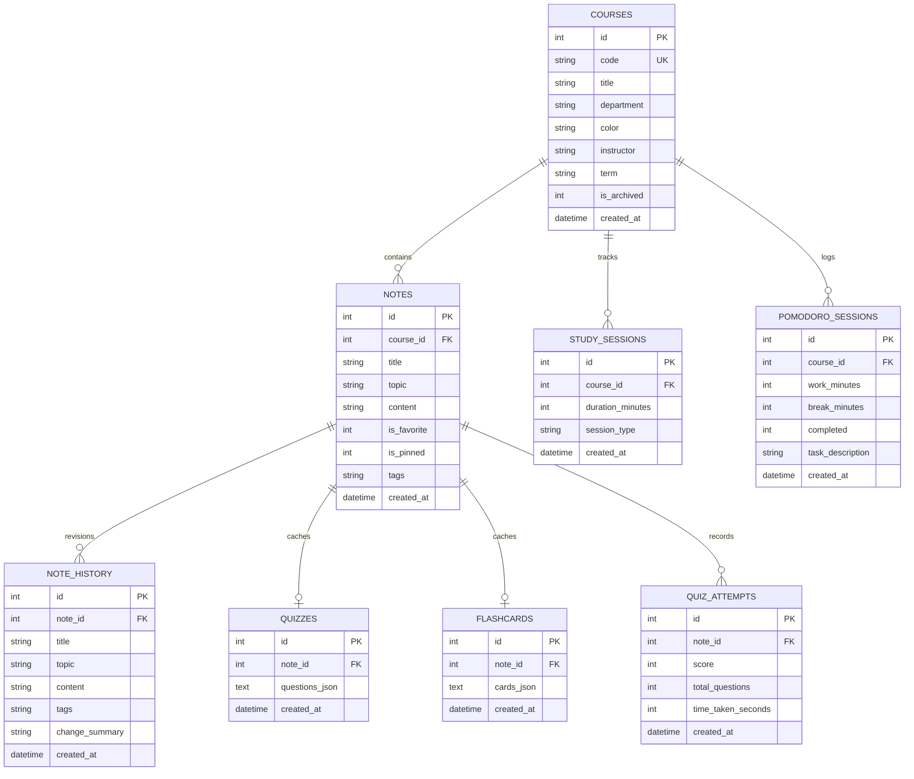

# 🏛️ StudyVault Architecture & Technical Specification

> **Course Notes Hub & AI-Powered Quiz & Flashcard Study Engine**

This document outlines the system architecture, database schema, algorithms, and design choices behind StudyVault.

---

## 🏗️ 1. High-Level Architecture Overview

StudyVault is engineered as a unified campus study platform comprising:
- **FastAPI Core Application Server** (`src/app.py`): RESTful endpoints with Pydantic v2 schemas and CORS middleware.
- **SQLite Relational Engine** (`src/database.py`): Zero-configuration embedded ACID database with cascading foreign keys and performance indexes.
- **Dual-Mode AI Engine** (`src/ai_generator.py`): Google Gemini 1.5 Flash API with a deterministic offline heuristic NLP fallback.
- **Spaced Repetition Scheduler** (`src/spaced_repetition.py`): SuperMemo-2 (SM-2) algorithm combined with Ebbinghaus forgetting curve modeling and FSRS memory stability metrics.
- **Interactive Single Page Application (SPA)** (`src/static/`): Tailwind CSS, FontAwesome 6, KaTeX LaTeX math rendering, and Prism.js syntax highlighting.

---

## 🗄️ 2. Database Schema & Entity Relationships

---

## 🧠 3. Spaced Repetition Scheduling Pipeline

StudyVault utilizes SuperMemo-2 (SM-2) for flashcard scheduling and active recall interval expansion:

1. **Rating Classification**:
   - `1 (Again)`: Memory lapse. Repetitions reset to 0, interval resets to 1 day.
   - `2 (Hard)`: Difficult recall. Ease factor reduced, minor interval boost.
   - `3 (Good)`: Standard successful recall. Interval multiplied by ease factor.
   - `4 (Easy)`: Instant effortless recall. Ease factor increased by +0.15.

2. **Ebbinghaus Forgetting Curve**:
   $$\text{Retention}(t) = \exp\left(-\ln(2) \cdot \frac{t}{\text{HalfLife}}\right) \times 100\%$$
   where $\text{HalfLife} \approx \text{interval\_days} \cdot (\text{ease\_factor} / 2.5)$.

3. **Memory Stability (FSRS)**:
   $$S = \text{interval\_days} \times \left(\frac{\text{ease\_factor}}{2.5}\right) \times \sqrt{\text{repetitions} + 1}$$
